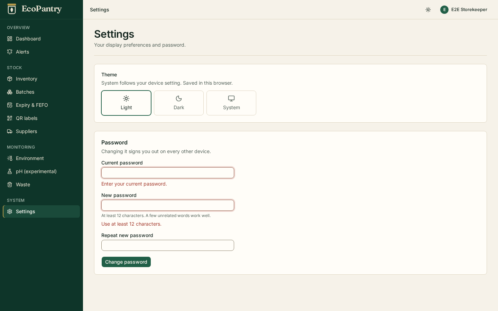
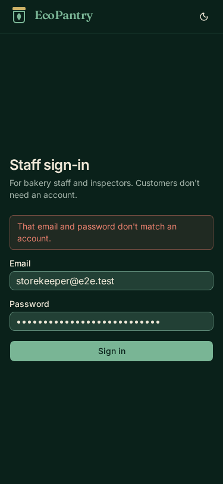
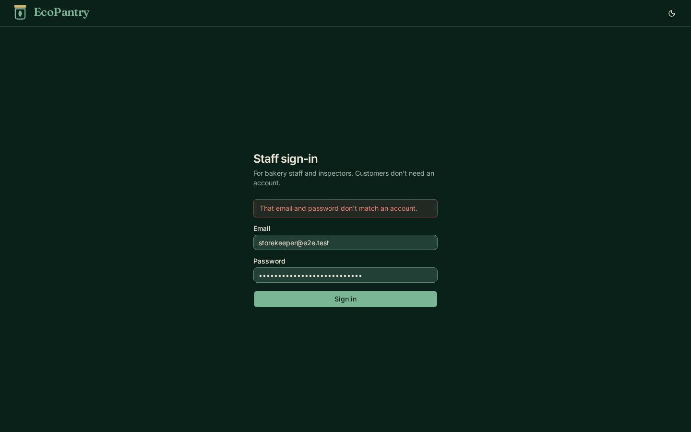
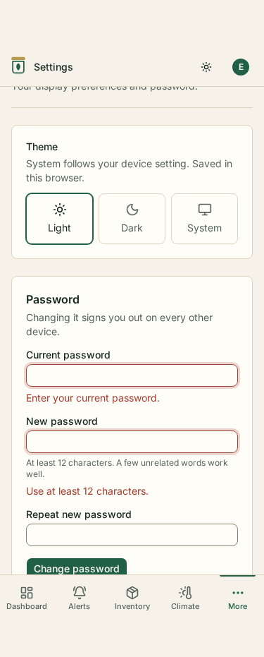
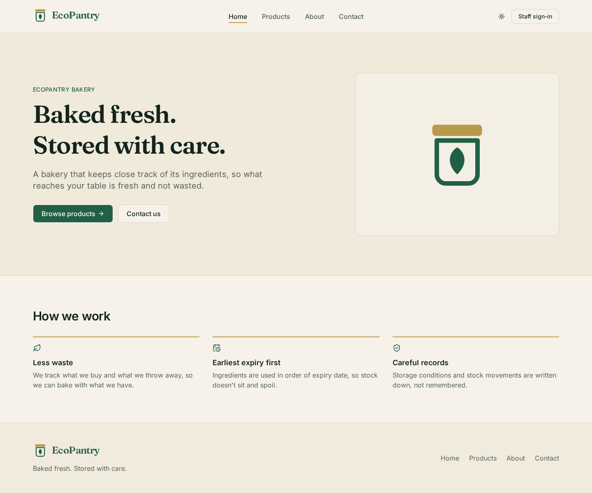
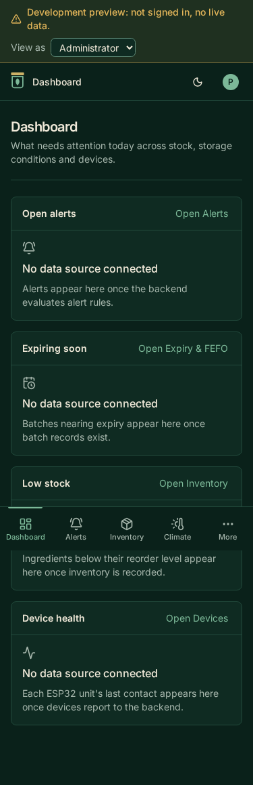

# Overnight report — 2026-11-02

Branch: `development`. Nothing was committed or pushed, and nothing was
deployed. All changes are uncommitted in the working tree, ready for review
(`git status`, `git diff`).

## Summary

| Phase | Result |
|---|---|
| 1. Responsive UI refinement | Already done in the last commit (`38df401`): 1280px content width, centred header nav, two-column hero, public mobile drawer, portal bottom bar. Re-verified, no layout changes needed. New auth screens checked at 375px and 1440px in both themes. |
| 2. Auth and database design | Done. Schema proposal in [docs/AUTH_DESIGN.md](AUTH_DESIGN.md). Implemented as migration `0002`. |
| 3. Secure authentication | Done. Argon2id, PostgreSQL sessions, HttpOnly cookie, CSRF, login/logout/me/password endpoints, backend permission checks, deactivation, lockout, audit log, bootstrap CLI. Frontend uses the real API. |
| 4. Testing | Done. Backend 24 → 113 tests; frontend unit 79 → 95; Playwright smoke 180 (unchanged, all pass); new full-stack Playwright suite with 11 tests. |
| 5. Documentation | Done: this report, `AUTH_DESIGN.md`, both READMEs, `CLAUDE.md`, `PROJECT_STATUS.md`, root README, `.env.example` files. |

Nothing was stopped part-way. The items under "Remaining issues" are
follow-up work, not unfinished parts of these phases.

## Phase 1: responsive UI

The previous session's commit already covered the requested points, with e2e
assertions for each: shared `container-page` (1280px max content, checked to
be 1200–1280px at 1440), header/content/footer left edges aligned within 1px
at six widths, nav centred within 2px, public hamburger drawer (44px+ targets,
focus trap, Escape, scroll lock, theme control), portal bottom bar below
1024px (Dashboard, Alerts, Inventory, Climate, More) with 44px tabs and
content clearance.

I re-ran the full smoke suite and reviewed screenshots rather than change
working layouts. New this session:

- Sign-in page: "Your session has ended" notice and clear messages for
  deactivated and locked accounts.
- Settings: a Password section (current, new, repeat) with inline validation,
  shown only for real sessions.
- Portal header: an alert if sign-out couldn't reach the server ("you're
  still signed in"), instead of silently pretending.
- The Employees module placeholder now says staff accounts are managed through
  the backend API until the Phase 9 screen exists.

No photography or products were added.

Screenshots (copied from the Playwright runs into `docs/images/overnight-2026-11-02/`):

| | |
|---|---|
|  |  |
|  |  |
|  |  |

In full-page captures, sticky headers and the fixed bottom bar appear
mid-page; that is how Playwright stitches full-page screenshots, not a layout
bug (the e2e suite separately asserts content clears the bar).

## Database schema implemented

Migration `website/backend/alembic/versions/20261101_0002_staff_auth.py`
(`0001 → 0002`). Additive only: it creates tables, an append-only trigger and
seed rows; nothing existing is altered or dropped. Applied to the development
database (`alembic current` = `0002`). It seeds the 3 roles and 25 permissions
(reference data) and creates **no accounts**.

```text
 roles 1──< role_permissions >──1 permissions
   1
   └──< employees 1──< auth_sessions
            1
            └──< audit_events (actor; nullable for anonymous/CLI)
```

| Table | Purpose |
|---|---|
| `roles` | `admin`, `storekeeper`, `inspector` with display names |
| `permissions` | 25 codes like `inventory.view`, `batches.manage` (format checked) |
| `role_permissions` | which role holds which permission |
| `employees` | staff accounts: normalised unique email, name, role, `active`/`disabled` status, Argon2id hash, lockout counters, timestamps; consistency CHECKs (e.g. `deactivated_at` set exactly when disabled) |
| `auth_sessions` | one row per signed-in browser: SHA-256 of the token, CSRF token, created/last seen/expires, revoked at/reason, IP, user agent |
| `audit_events` | append-only (trigger rejects UPDATE/DELETE): actor type and employee, action, target, IP, user agent, JSON details |

Full column list, lifecycle and the permission matrix: [AUTH_DESIGN.md](AUTH_DESIGN.md).
Inspectors hold only `*.view` permissions plus `reports.export`.

## API endpoints

| Method | Path | Access |
|---|---|---|
| POST | `/api/v1/auth/login` | public; JSON only |
| POST | `/api/v1/auth/logout` | public; CSRF header when a session exists |
| GET | `/api/v1/auth/me` | any session |
| POST | `/api/v1/auth/password` | any session + CSRF |
| GET | `/api/v1/employees` | `employees.view` (Administrator, Inspector) |
| POST | `/api/v1/employees` | `employees.manage` (Administrator) + CSRF |
| POST | `/api/v1/employees/{id}/deactivate` | `employees.manage` + CSRF |
| POST | `/api/v1/employees/{id}/reactivate` | `employees.manage` + CSRF |
| POST | `/api/v1/employees/{id}/password` | `employees.manage` + CSRF |

Existing `/health` and `/health/ready` are unchanged. Error responses keep the
`{detail, code}` shape; new codes: `invalid_credentials`, `account_disabled`,
`account_locked`, `not_authenticated`, `session_expired`, `csrf_failed`,
`forbidden`, `password_rejected`, `invalid_current_password`, `invalid_employee`.
Request/response details are in `website/backend/README.md` and the live
OpenAPI docs at `/api/v1/docs`.

## Security decisions

- **Passwords:** Argon2id via `argon2-cffi` 25.1 (RFC 9106 low-memory profile:
  t=3, 64 MiB, p=4), rehashed on sign-in if parameters change. 12–128
  characters, not equal to the email, no composition rules.
- **Sessions:** opaque 256-bit random tokens, stored only as SHA-256, so a
  database copy can't be used to sign in. Idle timeout 60 min, absolute 12 h,
  both configurable. `last_seen_at` is written at most once a minute.
- **Cookie:** `HttpOnly; SameSite=Lax; Path=/; Max-Age=43200`. When
  `SESSION_COOKIE_SECURE` is on (the default in production, and production
  refuses to turn it off) it is also `Secure` and named
  `__Host-ecopantry_session`.
- **CSRF:** per-session token returned in the login/me JSON, kept in memory by
  the frontend, required as `X-CSRF-Token` on every authenticated unsafe
  request (enforced centrally in the auth dependency, so new endpoints get it
  automatically). Login accepts JSON only, which cross-site forms can't send.
- **Brute force:** 5 wrong passwords → 15-minute lockout (429). Unknown emails
  still run a dummy Argon2 check so timing doesn't reveal which emails exist.
  Trade-off (documented): the 429 does reveal an email exists after 5 tries.
- **Deactivated accounts:** refused with 403 only after a correct password;
  deactivation, admin password resets and the user's own password change revoke
  sessions immediately. Admins can't deactivate themselves or the last active
  admin.
- **Permissions:** enforced by the backend through
  `require_permission(Permission.X)`. A test enumerates every route in the
  OpenAPI schema and fails if any non-public route answers without a session.
  Frontend role checks remain UX only.
- **No default credentials:** the first administrator comes from
  `python -m app.cli create-admin`, which refuses once any administrator
  exists. Passwords are taken only from a hidden prompt (typed twice) or
  `--password-stdin`, never from command-line arguments.
- **No secrets in logs or audit:** no code logs request bodies; `repr()` of
  employees and sessions omits hashes and tokens; 422 responses never echo
  input; the typed email of an unknown account isn't stored (people sometimes
  type a password there). A test checks password, token, CSRF token and hash
  never appear in captured logs or audit rows.
- **Caching:** every `/api/v1` response has `Cache-Control: no-store`.
- **Client IP:** taken from the direct peer only; `X-Forwarded-For` is not
  trusted (it can be forged). Behind a reverse proxy this needs configuring
  (see remaining issues).
- **Preview mode:** still available locally with `VITE_PORTAL_PREVIEW=true`,
  has no cookie and no permissions, and is absent from production builds
  (`grep -r "Development preview" dist/` finds nothing).

## Tests and results

All results below are from the final run on 2026-11-02, after all changes.

| Suite | Command | Result |
|---|---|---|
| Backend, all (unit + PostgreSQL integration) | `.venv/bin/pytest` | **113 passed** (was 24) |
| Backend, no database | `.venv/bin/pytest -m "not integration"` | 53 passed |
| Models vs migrations | `.venv/bin/alembic check` | No new upgrade operations detected |
| Frontend lint | `npm run lint` | 0 errors; 1 warning that was already there (`components/ui/button.tsx`, shadcn file) |
| Frontend unit | `npm test` | **95 passed** (was 79) |
| Frontend build | `npm run build` | OK; preview code absent from `dist/` |
| Playwright smoke (preview, no backend) | `npm run test:e2e` | **180 passed** |
| Playwright full-stack (real API + DB) | `npm run test:e2e:fullstack` | **11 passed** (new) |

New backend tests by area:

- `test_security.py`: Argon2id hashing, salts, verification, malformed hashes, rehash detection, password rules, token randomness and hashing, CSRF comparison.
- `test_auth.py`: login success for each role (body, permissions, cookie flags, hash-only storage, audit), case-insensitive email, identical answers for wrong password and unknown email, JSON-only login, no password echo, lockout and recovery, deactivated accounts, session replacement, `/me`, made-up and tampered cookies, absolute/idle/revoked expiry, idle extension, deactivation ending sessions, CSRF on unsafe routes (missing, empty, wrong, other session's token), logout and cookie replay, password change keeping this session and ending others, wrong current password not signing out, weak/unchanged new passwords, no secrets in logs or audit.
- `test_employees.py`: who can list staff, no password material in responses, Inspector and Storekeeper refused on every change with nothing written, Inspector session holds only read permissions, account creation, validation, duplicate emails, deactivate/reactivate, self-deactivation and last-admin protection, admin password reset ending sessions, 404.
- `test_cli.py`: create-admin works and refuses a second time, weak password refused, no password from a non-terminal without the flag, no `--password` argument exists, set-password/deactivate/reactivate, purge-sessions.
- `test_permissions.py`: Inspector read-only, admin holds all, storekeeper limits, database seed equals the code.
- `test_route_protection.py`: every non-public route returns 401 without a session.
- `test_migrations.py` (extended): `0001 → 0002 → 0001` on a scratch database, seed contains only reference data, models match the migrated schema, audit log is append-only, employee CHECK constraints.

New frontend tests:

- `src/features/auth/auth.test.tsx` (real AuthProvider, router and client, mocked `fetch`): public pages make no API calls, session restored on portal entry, redirect to sign-in and back, 401/403/429 messages, malformed login response refused, nothing in browser storage, sign-out sends CSRF and doesn't return to the old page, sign-out failure keeps the user signed in, any 401 ends the session with a notice and a return path, password change sends CSRF, client-side password validation.
- `src/lib/api/client.test.ts` (extended): CSRF header only on unsafe methods, cookies included, 401 listener and `ignoreUnauthorized`, error codes.
- `e2e/fullstack/auth.fullstack.ts`: admin sign-in, HttpOnly/SameSite cookie not readable by scripts, session survives reload, sign-out ends it on the server; wrong password and deactivated messages; Inspector UI and API (GET allowed, POST 403); Storekeeper blocked from admin page and API; CSRF-less POST refused; deactivation ending an open browser session; full password change; screenshots and overflow checks at 375/1440 in light and dark.

Mutation checks: I temporarily removed the CSRF header from the API client
(3 tests failed) and reverted the sign-out fix below (1 test failed), then
restored both. The tests do detect these regressions.

Bug found and fixed by the full-stack tests: after a deliberate sign-out from
a portal page, the next person to sign in was sent back to that page instead
of the dashboard (a race between the lazy-loaded sign-in route and the route
guard). Auth state now records why the user was signed out, and the return
path is kept only when the server ended the session.

## Files changed

New:

- `docs/AUTH_DESIGN.md`, `docs/OVERNIGHT_REPORT.md`, `docs/images/overnight-2026-11-02/*.png` (6 screenshots, 316 KB)
- Backend: `alembic/versions/20261101_0002_staff_auth.py`; `app/auth/{__init__,permissions,service,dependencies,cookies}.py`; `app/core/{security,middleware}.py`; `app/models/{auth,audit}.py`; `app/schemas/{auth,employees}.py`; `app/api/v1/routes/{auth,employees}.py`; `app/services/{__init__,audit,employees}.py`; `app/cli.py`; `scripts/e2e_server.py`; `tests/test_{auth,cli,employees,permissions,route_protection,security}.py`
- Frontend: `src/features/auth/{ChangePasswordForm.tsx,auth.test.tsx}`; `playwright.fullstack.config.ts`; `e2e/fullstack/auth.fullstack.ts`

Modified:

- Backend: `pyproject.toml` (adds `argon2-cffi>=25.1,<26`), `.env.example`, `README.md`, `app/core/config.py` (session settings), `app/core/errors.py` (401/403/429 errors, extra headers), `app/factory.py` (no-store middleware), `app/models/__init__.py`, `app/api/v1/router.py`, `tests/conftest.py` (scratch database fixtures moved here, auth fixtures), `tests/test_config.py`, `tests/test_migrations.py`
- Frontend: `src/lib/api/client.ts` (CSRF, 401 listener, error codes), `src/features/auth/{AuthProvider.tsx,auth-context.ts,RequireAuth.tsx,SignInPage.tsx,roles.ts,schemas.ts,preview.ts}`, `src/components/layout/PortalLayout.tsx`, `src/pages/portal/SettingsPage.tsx`, `src/config/portal-modules.ts` (Settings summary, Employees placeholder text), `src/app/routes.test.tsx`, `src/lib/api/client.test.ts`, `package.json` (`test:e2e:fullstack` script), `.gitignore`, `.env.example`, `README.md`
- Repository: `CLAUDE.md`, `README.md`, `docs/PROJECT_STATUS.md`

Not touched: any `.env` file, `compose.yaml`, the PostgreSQL volume.

Database changes on this machine:

- Development database `ecopantry`: migrated `0001 → 0002`. It has 3 roles, 25
  permissions, 0 employees and 0 sessions. It also has **one** audit row
  (`auth.login_failed`, anonymous, no email stored) from my manual curl check
  that the running server refuses an unknown login; the audit table is
  append-only, so I left it.
- Test databases (`ecopantry_test_*`, `ecopantry_test_e2e`) are created and
  dropped by the test runs; none are left.

## Remaining issues

1. **Production origin / cookie setup (decide before deployment).** The
   planned hosting (Cloudflare Pages + Render) puts the frontend and API on
   different origins. `SameSite=Lax` cookies won't be sent on cross-site
   `fetch`, and there is no CORS. Recommended: serve the API under the same
   origin as the site (e.g. route `/api/v1/*` to Render through Cloudflare),
   which needs no code change. Alternatives (sibling subdomains plus CORS with
   credentials, or `SameSite=None`) need code and a documented decision. I
   didn't pick one because it's a deployment architecture decision.
2. **No staff-management screen yet.** Admins manage accounts through the API
   (`/api/v1/docs`) or the CLI. Changing an employee's role isn't implemented.
3. **Audit log tamper-resistance.** The trigger stops the app from editing or
   deleting audit rows, but the API connects as the database owner, which can
   drop the trigger. A separate, less-privileged database role for the API
   would close that. `TRUNCATE` is also not blocked (the tests use it on
   throwaway databases).
4. **Rate limiting** is per account only. Per-IP limits belong in the reverse
   proxy. Behind a proxy, client IPs in sessions and audit rows will show the
   proxy's address until trusted-proxy handling is configured.
5. **Two administrators deactivating each other at the same moment** could
   leave none active. Unlikely at bakery scale; the CLI `reactivate` recovers.
6. **Session cleanup** isn't scheduled; run `python -m app.cli purge-sessions`
   periodically (cron or similar) once deployed.
7. The preview user has no permissions, so any future UI that hides controls
   by permission will hide them in preview mode too.
8. The pre-existing oxlint warning in `src/components/ui/button.tsx` (a
   generated shadcn file) is unchanged.

## Exact commands

From the repository root:

```bash
podman-compose up -d && podman-compose ps        # PostgreSQL, wait for (healthy)
```

Backend (`website/backend/`):

```bash
.venv/bin/pip install -e ".[dev]"                 # installs argon2-cffi (new dependency)
.venv/bin/alembic upgrade head                    # already applied here; safe to re-run
.venv/bin/python -m app.cli create-admin --email you@example.com --name "Your Name"   # prompts for a password
.venv/bin/uvicorn app.main:app --reload --host 127.0.0.1 --port 8000
.venv/bin/pytest                                  # 113 tests, needs PostgreSQL
.venv/bin/pytest -m "not integration"             # no database
.venv/bin/alembic check
```

Frontend (`website/frontend/`):

```bash
npm install
npm run dev                                       # http://localhost:5173/portal/sign-in
npm run lint && npm test && npm run build
grep -r "Development preview" dist/               # should print nothing
npm run test:e2e                                  # smoke suite, no backend needed
npm run test:e2e:fullstack                        # needs PostgreSQL and the backend venv
```

To sign in for real in development, leave `VITE_PORTAL_PREVIEW` unset or
`false` in `website/frontend/.env.local`. On this machine it's currently set
(I didn't change it), so the portal shows the preview session until you change
it.
