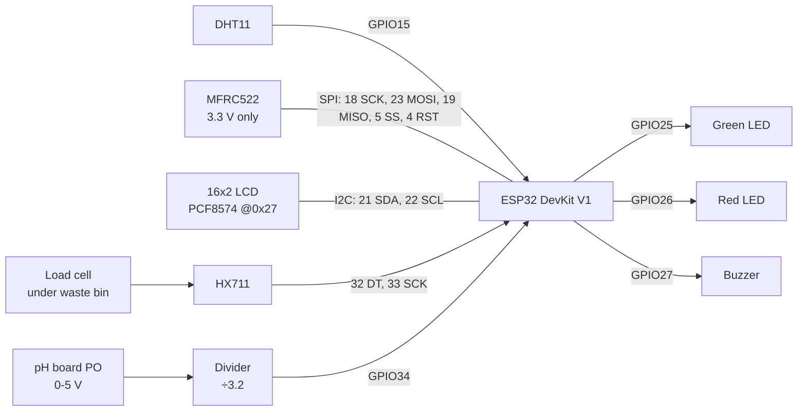

# Inventory station: wiring (single-ESP32 prototype)

The prototype puts every sensor on **one ESP32 DevKit V1** (ESP32-WROOM-32, 30/38-pin): storage climate, the waste-bin load cell, the pH probe, the RFID reader and the display. The separate waste-bin controller planned in the README is not built. The HC-SR04 fill-level sensor is not fitted yet (see [../smart-waste-bin/README.md](../smart-waste-bin/README.md)).

Firmware: [software/firmware/inventory-esp32](../../software/firmware/inventory-esp32/README.md). The pins below are the ones in its `include/config.h`, taken from the working all-sensors sketch.

## Pin map

| Part | Part pin | ESP32 pin | Notes |
|---|---|---|---|
| **DHT11** | DATA | GPIO 15 | 10 kΩ pull-up to 3.3 V (most 3-pin modules have one) |
| | VCC / GND | 3.3 V / GND | |
| **MFRC522** | SDA (SS) | GPIO 5 | **3.3 V only**. 5 V damages it. |
| | SCK | GPIO 18 | VSPI |
| | MOSI | GPIO 23 | VSPI |
| | MISO | GPIO 19 | VSPI |
| | RST | GPIO 4 | |
| | 3.3V / GND | 3.3 V / GND | IRQ not connected |
| **LCD 16x2 + PCF8574 backpack** | SDA | GPIO 21 | I2C address 0x27 |
| | SCL | GPIO 22 | |
| | VCC / GND | 5 V (VIN) / GND | See the I2C note below |
| **HX711** | DT (DOUT) | GPIO 32 | |
| | SCK | GPIO 33 | |
| | VCC / GND | 3.3 V / GND | Load cell on E+/E-/A+/A- |
| **pH board** | PO (analog out) | GPIO 34 **through the divider** | ADC1, input-only. Never wire PO straight to the pin. |
| | VCC / GND | 5 V / GND | |
| **Green LED** | anode (via 220–330 Ω) | GPIO 25 | |
| **Red LED** | anode (via 220–330 Ω) | GPIO 26 | |
| **Buzzer** | signal | GPIO 27 | Active-LOW in this build: the pin HIGH is silent |

## Power

- Power the board over USB (5 V) or a regulated 5 V supply into VIN.
- 3.3 V rail (from the DevKit regulator): MFRC522, DHT11, HX711.
- 5 V rail (VIN): LCD backpack and pH board.
- All grounds are common.
- The DevKit's regulator can supply a few hundred mA. WiFi transmit peaks plus the LCD backlight are fine on USB, but avoid long thin USB cables, which cause brown-out resets during WiFi start-up.

## Cautions

- **MFRC522 is a 3.3 V part.** Never feed it 5 V.
- **pH board output can reach about 5 V; the ESP32 ADC pin must stay at or below 3.3 V.**
  - The firmware assumes a resistor divider with ratio 3.2: board voltage = pin voltage × 3.2.
  - Example: 22 kΩ from PO to GPIO34, and 10 kΩ from GPIO34 to GND, gives ÷3.2.
  - Measure the actual divider. If its ratio differs, change `kPhDividerRatio` in `include/config.h` and recalibrate.
  - With the divider, 5 V at PO is about 1.56 V at the pin, well inside the 11 dB ADC range.
- **I2C with a 5 V LCD backpack.** PCF8574 backpacks often pull SDA/SCL up to 5 V.
  - The ESP32 usually tolerates this through the backpack's 4.7–10 kΩ pull-ups, but it is out of spec.
  - For a long-running build, remove the backpack's pull-ups and add 4.7 kΩ pull-ups to 3.3 V, or use an I2C level shifter.
- GPIO 34 is input-only and has no internal pull-up. That's fine for an analog input.
- **GPIO 5 is a strapping pin.** The MFRC522's SS line is normally high at boot, which is what the ESP32 expects. If the board fails to boot with the reader attached, check the reader's wiring first.
- **The load cell and fill level need calibration against the real bin** (see the firmware README). The cell must take the bin's whole weight; mount it so nothing else carries the load.
- **pH is experimental.** A hobby pH board read through the ESP32 ADC is not a food-safety instrument. Never use it alone to decide whether food is safe or spoiled. EcoPantry is a prototype, not a certified food-safety system.
- Keep liquid samples away from the electronics, and keep mains wiring out of this enclosure.

## Bring-up checklist

1. Flash the firmware with no network secrets yet. The LCD shows `CONFIG ERROR` on the status page, but every sensor page should already work.
2. The DHT11 page shows a plausible room temperature and humidity.
3. Run `tare` with the bin empty, then `cal <grams>` with a known weight. Check the reading returns to 0 g.
4. Put the pH probe in pH 7 buffer: the reading should be near 7 after `ph cal`.
5. A card tap shows `CHECKING CARD`. Then add `secrets.h`, register the device, and check that a tap reaches the server (`[api] POST /device/rfid-scans -> 200` on the serial console).
